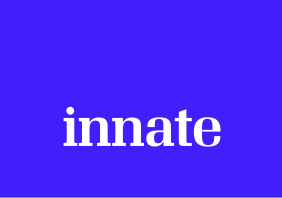

  

  <strong>Your personal robot</strong> 
  coming soon

The personal robot / physical AI agent will be the biggest product of our time.

It should not be kept closed.

---

## Previous robots by Innate

### MARS

MARS is our first-generation robot for builders. It brings together open-source hardware, Innate OS, and an AI stack for running VLAs, embodied agents, and agentic workflows on a ~$995 platform.

- [**MARS product page**](https://www.innate.bot/mars)
- [**innate-os**](https://github.com/innate-inc/innate-os) — The robot operating system
- [**mars**](https://github.com/innate-inc/mars) — Hardware design files (~$1k BOM if sourced individually)
- [**docs**](https://docs.innate.bot) — Full documentation

**MARS beta** — beta users get access to CAD, URDF, the OS, and a home environment simulation. The OS and simulation work for anyone; for the best hardware experience, we recommend our kit.

[Innate website](https://www.innate.bot/) · [Discord](https://discord.com/invite/KtkyT97kc7)
